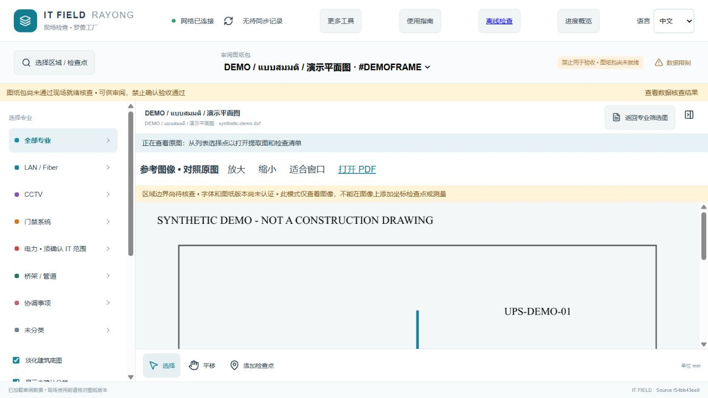

# ITCAD Management · IT Field Rayong

A self-hosted CAD review and field inspection workspace for **IT networks, LAN, fiber, CCTV, access control, cable pathways, and electrical coordination**. It provides traceable drawing references, server-side previews, checklists, progress summaries, and a separate offline inspection workspace.

**Status: 0.5.0 · pilot / review workspace.** This is not an engineering approval system or a full DWG editor. All included demo geometry and reference images are synthetic. Construction acceptance remains blocked until approved revisions and project acceptance criteria have been independently verified.

The application supports **English, Thai, and Simplified Chinese**. Repository documentation, commit messages, pull requests, and release notes use English as the primary language. Drawing text, identifiers, units, and inspection evidence retain their original language.



## Quick start on Windows

Read [Start here: workspace map and complete first-use workflow](docs/getting-started.md) before choosing a link. Static hosting is the presentation/trial shell; the Windows field server is the full inspection application.

1. Install [Node.js](https://nodejs.org/) 22.13 or later and Git, then clone:

   ```powershell
   git clone https://github.com/ZKZZyling/ITCADManagement.git
   cd ITCADManagement
   ```

2. Double-click **`Setup-ITField.cmd`** once. It installs locked dependencies, builds the interface, and generates the synthetic demo. An existing active drawing package is preserved.
3. Double-click **`ITField-Control.cmd`** and start the local workspace. The launcher uses port `42873` and opens a paired browser link automatically.
4. Select a sheet, search for a tag or device, open the inspection checklist, and save the status, notes, assignee, and photos. Synchronize when ready; resolve pending conflicts before retrying.
5. For an authorized external team, start the temporary team link and share its paired URL through an approved company channel. Keep the server computer running. Read the [field guide](docs/field-guide.md) and [offline guide](docs/offline.md) before leaving for site.

For development, run each command and check its result before continuing:

```powershell
npm ci
npm run build
npm run demo
npm test
npm start
```

`npm start` starts only the server; it does not open or pair a browser. Use the Windows launcher, or POST the local token from `data/pair-token` to `/api/pair` for development. Never publish that token in Git, an issue, or a screenshot.

## New workspaces in 0.5.0

The [contextual field assistant](docs/field-assistant.md) provides paperclip-inspired guidance from current page state in English, Thai and Simplified Chinese. It can point to controls and explain recovery without sending data to an AI service or performing inspection actions for the user.

- **Local analysis:** separate loopback admin service and durable single-worker queue; verify every scene part, cancel/retry, and explicitly activate review packages. Original drawings remain unchanged.
- **Management:** read-only viewer links, multilingual evidence dashboard, and private checksum-verified presentation bundles.
- **Isolated trial:** demonstrate checklist entry using real snapshot references without writing production progress.
- **Static presentation:** build a code-only Render/Netlify artifact; supervisors import a privately supplied bundle locally.

See [workspace operations and static hosting](docs/workspaces.md) for configuration, data boundaries, and exact launch steps. Raw DWG conversion still requires a verified ODA installation. A static viewer is not the field backend.

## Capabilities and boundaries

### IT–ERP implementation readiness

Open **IT–ERP readiness** from the field workspace to prepare rooms, racks,
equipment loads, explicit cable/port links, ERP service dependencies and
construction-stage evidence. The planner provides 36 generic requirements in
Thai, Simplified Chinese and English, drawing-scoped private drafts, validated
JSON exchange, versioned server saves and a read-only viewer mode.

The topology shows only manually recorded links. Unknown loads stay unknown;
known-input totals do not size a UPS or cooling system. Planning evidence and
test records do not grant engineering approval, prove installation, or configure
ERP/network equipment. Factory-specific plans must remain private.
See [Readiness planning and construction coordination](docs/readiness.md).

| Area | Implemented behavior | Boundary |
|---|---|---|
| Drawing selection and filtering | LAN/fiber, CCTV, access, power, pathways, coordination, and unknown candidates | Classification uses layer/text heuristics and requires legend verification; it is not AI-certified identification. |
| Reference viewing | Select and zoom server-prepared images | Demo images are synthetic. Production references must be prepared from verified author output. |
| Geometry review | Server raster and optional MLight DXF viewer | Derived review geometry does not guarantee every dynamic block, Xref, font, hatch, or proxy entity. |
| Inspection records | Checklists, notes, assignees, photos, local queues, and version conflicts | Installed/tested statuses are user-entered evidence, not proof of physical completion. |
| Progress | Status counts scoped to source SHA and dataset | No construction completion percentage is inferred without an approved bill of quantities. |
| Offline inspection | Explicit preparation, separate page, export/import, and later synchronization | Requires HTTPS/localhost and a complete pack in the same browser origin; changed URLs require export/import. |
| Languages | English, Thai, and Simplified Chinese UI | Source drawing text and notes remain unchanged. |
| Team access | localhost.run HTTPS through Windows OpenSSH | External provider, rotating URLs, and no uptime guarantee. Cloudflare is optional and has documented DNS limits. |
| AI assistance | Export traceable evidence JSON for expert or ChatGPT review | No automatic AI API, autonomous DWG editing, or engineering approval. ChatGPT Pro does not automatically include API usage. |

## Documentation by role

| Reader | Start here |
|---|---|
| New inspector | [Field workflow](docs/field-guide.md), [offline preparation](docs/offline.md) |
| System administrator | [Installation](docs/installation.md), [operations](docs/operations.md), [security](SECURITY.md) |
| Manager | [Progress interpretation](docs/field-guide.md#managers-and-multilingual-teams), [limitations](docs/limitations.md) |
| CAD preparer | [CAD pipeline and quality gates](docs/cad-pipeline.md) |
| Developer | [Architecture](docs/architecture.md), [API/data formats](docs/api-data.md), [testing](docs/testing.md), [contribution guide](CONTRIBUTING.md) |
| Maintainer | [Publication workflow](docs/publishing.md), [project instructions](AGENTS.md), [changelog](CHANGELOG.md) |
| Analysis and presentation planner | [Local analysis workspace and real-drawing presentation design](docs/analysis-workspace-design.md) (implemented foundations; remaining engineering gates documented) |
| Deployment reviewer | [Validation evidence](docs/release-validation.md), [roadmap](docs/roadmap.md), [third-party notices](THIRD_PARTY_NOTICES.md) |

## Repository layout

```text
client/                 React UI, locales, field workflow, offline packs / IndexedDB
server/                 Node HTTP server, SQLite, raster and proxy-origin guard
lib/validation.mjs      Shared record and checklist validation
scripts/                Build, synthetic demo, Windows controller, CAD preparation
tests/                  Portable unit tests and isolated server integration
public/field/           HTML, manifest, service worker source
docs/                   Installation, operations, architecture and evidence
.github/workflows/      Windows/Linux CI and synthetic CAD regression
data/                   Private runtime storage; generated and not tracked
public/field/assets/    Generated browser bundles; not tracked
```

## License and company data

Application source is licensed under [MIT](LICENSE). Real drawings, Xrefs, PDFs, site photos, inspection records, credentials, and pairing tokens are **not included in this repository or licensed as application source**. Dependencies and CAD converters retain their own terms; see [third-party notices](THIRD_PARTY_NOTICES.md).

Before production inspections, verify Approved for Construction (AFC) revisions, legends, specifications (SPEC), inspection and test plans (ITP), fonts, sheet boundaries, and dependencies. Test real devices and networks using the [acceptance checklist](docs/testing.md).

### Drawing focus and source evidence

The field workspace includes whole-sheet reference fitting, zoom/drag scrolling, fullscreen focus (with a browser fallback), reversible system highlighting/isolation, and exact-layer filtering. Interactive extracted geometry exposes original text, source handles, nearby notes and geometry lengths in both the inspector and contextual assistant. Read [Drawing review and evidence](docs/field-guide.md#fullscreen-drawing-review-and-object-evidence) before interpreting these values: classification and connectivity remain provisional; image registration and engineering approval are not certified by this interface.
