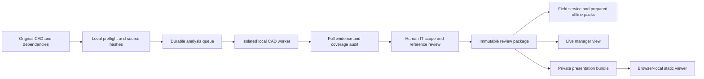

# Local analysis workspace and real-drawing presentation design

Status: **0.5.0 foundations implemented**. The separate local queue, worker lifecycle, manager authorization, private snapshots, and isolated trial are implemented. See [current workspace operations](workspaces.md) for actual behavior. The remaining sections retain the target architecture; dependency-aware reuse, complete native fidelity, enterprise identity, and engineering release are still planned, not deployment readiness claims.

## Decision

Keep source CAD processing on the operator's Windows workstation. Separate it from field HTTP requests in both the interface and runtime processes. Prepare traceable, versioned IT review packages, then serve or privately export those packages for managers and inspectors. A separate browser page alone does not isolate CPU, memory, or failures; the analysis worker must be a separate process with an explicit resource and lifecycle policy.

Provide three coordinated workspaces:

| Workspace | User | Primary workflow |
|---|---|---|
| Analysis | Local CAD/IT administrator | Select source → analyze → review evidence → prepare package |
| Management | Authorized supervisor | Overview → area/system → evidence and issues → presentation |
| Field | Inspector | Select area → inspect → attach evidence → save/synchronize |

Use the existing approved local server/tunnel for live real-data presentation first. A stable static-hosted viewer can later load a privately supplied review package directly in the supervisor's browser. Deploying viewer code is different from uploading company drawings; real data must not be embedded in a public static site or public Git history.

## Current implementation and gaps

The project already has independent extraction, preparation, audit and optimization scripts, a local HTTP server, server-generated raster views, source/dataset-scoped records, offline pack export/import, and multilingual interfaces. CAD preparation is not performed by a field browser request today.

Version 0.5.0 implements the analysis interface, JSON job queue, progress/cancellation, restart interruption, separate worker process, explicit reviewed-package activation, shared viewer capability, and presentation bundle. Dependency/configuration-aware reuse and full resource admission controls remain open. The existing standalone offline page is a useful starting point, but importing a pack does not establish a production read-only management role.

## Proposed architecture



The operator can reach Analysis from the local controller and an administrator-only navigation entry. Management and Field stay lightweight and do not start conversion jobs. The admin analysis service should bind to loopback on its own configurable/available port; the public field tunnel forwards only the field service.

Do not rely solely on a loopback peer check: public tunnel requests can also arrive from a loopback proxy. Use a separate local service, an administrator credential distinct from the shared field pairing token, Origin/CSRF checks, and explicit endpoint authorization. A link containing `localhost` refers to the device opening it; remote tablets must not receive a misleading local-analysis link.

## Analysis workflow and quality gates

1. **Source preflight:** select files locally; preserve original bytes; hash DWG/DXF and known dependencies; inventory Xrefs, raster/underlay resources, fonts, units, layouts, drawing index, revision and available legend/SPEC/ITP. Record missing evidence instead of inventing it.
2. **Extraction:** use an explicitly selected lawful converter/native route. The current portable DXF/optional ODA route does not auto-launch AutoCAD. Preserve extraction warnings, unsupported entities, hidden layers, transformations and provenance. Do not silently repair, bind, explode or save over original files.
3. **IT scope review:** collect networks/fiber, racks/MDF/IDF, CCTV, access, pathways and scoped IT power. Retain fire/interface/architectural coordination context, unknown candidates and potential relevant omissions. Keyword/AI suggestions are candidates until matched to source evidence and legends.
4. **Package preparation:** generate thumbnails, readable references, per-area geometry, text/tag indices, checklist suggestions and issue lists. Review sheet boundaries, source text, font substitution and skipped objects; uncertain associations remain visible.
5. **Publish for review:** validate the package, select areas, and atomically change the active review package. A failed job leaves the old package active. Engineering acceptance is a separate signed project process; technical package readiness never implies AFC approval.

Large files should be selected on the server workstation instead of uploaded through a public browser. Remote file upload, if introduced later, needs authentication, streaming, size/space limits, explicit company approval and a separate staging area. A remote browser cannot read arbitrary workstation folders.

## Job orchestration

Proposed job states:

```text
queued → preflight → extracting → indexing → preparing → auditing
       → awaiting_review → ready_for_review_package → published_for_review
       ↘ failed / cancelled / interrupted
```

Persist job identity, stage, attempts, heartbeat, selected source/dependencies, configuration and tool versions, checkpoint outputs, English operational logs, cancellation intent and actionable errors. After a restart, mark orphaned workers interrupted and verify checkpoints before reuse. Never interpret a missing process as successful completion.

Start with one analysis job at a time. Use a separate worker process, bounded I/O, disk-space checks, per-stage timeout/cancellation and adjustable low priority. Validate actual CPU/RAM impact on the field server and unrelated applications before claiming isolation. Cancelling a job stops only owned child processes; it does not terminate user CAD, SSH, Node, ERP or other unrelated processes by name.

If individual stage progress is unavailable, show the current stage, elapsed time and completed counts. Do not fabricate overall percentages or precise completion times. Retry only the failed safe stage when its source/configuration prerequisites still match. Known corrupt inputs require a fresh source or an explicitly justified recovery route, not repeated crashes.

## Reuse and revision identity

The cache identity should include source SHA-256, dependency hashes, parser/converter version, extraction settings, classification rules, reference settings and package schema. Reusing by filename or primary DWG hash alone is insufficient when an Xref, legend or configuration has changed.

Reuse unchanged validated outputs. Rebuild affected units only after dependency tracking can prove independence; keep a full rebuild as the safe fallback. Generate a new dataset identity for materially different extraction or mapping, even when the primary source bytes are unchanged. Do not automatically carry inspection acceptance across revisions. Suggested record migration must show old/new evidence and require an explicit decision.

## Data package contract

Proposed logical contents (schema and transport still need implementation):

```text
manifest                  Schema/tool versions, source/dependency hashes, purpose
revision                  Source labels, approval evidence and outstanding gaps
views                     Area/sheet identity, boundary and association status
references                Per-view image/PDF metadata, integrity hashes and quality
assets                    Original tags/text, handles/layers, scope and uncertainty
relations                 Confirmed/candidate endpoints, circuits, racks and routes
issues                    Missing evidence, conversion skips and review decisions
inspectionSnapshot        Source-scoped records, photos and synchronization timestamp
coverage                  Included, excluded, unknown and unsupported content
integrity                 Hash inventory; optional technical signing metadata
```

Never include pairing tokens, server credentials, arbitrary local absolute paths or the raw full CAD set in an ordinary field/presentation package. Include the dependencies or original files only in a separately authorized engineering handover. Hashes demonstrate byte integrity, not engineering approval. Technical signatures do not replace the responsible engineer's signature.

Keep original text next to a separate translation, with source references. Distinguish confirmed assets from text candidates and block definitions. Reconcile duplicate tags across plans/risers/details before proposing quantities. Route lengths must retain units and explicit vertical/slack assumptions; they are not automatically certified cable quantities.

## Lightweight viewing and performance

Precompute references and thumbnails; load the selected area rather than the whole model. Generate geometry chunks/tiles only where needed. Lazy-load CAD tools and full-resolution references. Preserve an explicit completeness/quality indicator when any representation is simplified.

The current renderer rejects overly dense views rather than silently dropping objects; preserve that behavior until a tested tiling mechanism replaces it. Server conversion and large JSON parsing must stay outside field request handlers. Raster images require a verified coordinate transform before measurements or point overlays can be asserted to match CAD coordinates.

Store offline pictures as browser Blobs in the future to reduce JSON/base64 overhead; version the importer and keep compatibility with existing packs. Check estimated quota, prepare only selected areas, and verify every required image before reporting offline readiness. Browser persistence is not a backup: retain export/recovery and unsynchronized-evidence warnings.

Performance targets must be measured, not advertised before implementation. Record cold/warm page and first-reference latency, search latency, peak worker/server/browser RAM, packet size, network bytes, save/sync behavior and relevant percentiles. Use the same dataset/device/network before and after changes. A health endpoint response is not a drawing-load or full inspection benchmark.

## Real-data presentation for Thailand and China

### Live mode

Use the local server and the already approved HTTPS tunnel for the current real dataset. Prepare the selected areas and Chinese UI before the meeting; verify pairing, reference loading, notes/photos and record synchronization. Keep the workstation powered and awake. Clearly label drawing readiness and distinguish demonstration records from production inspections.

A short-lived shared field token is not a read-only manager role. Implement a separate viewer capability/server authorization before broader supervisor access. Show source/revision, last synchronization time, record counts, blocked issues and evidence links. Construction percentage needs an approved denominator; do not infer it from inspected record counts.

### Browser-local presentation mode

Host only the viewer application code on Render Static Site or Netlify. Privately provide one versioned presentation bundle to the supervisor through an authorized company channel. On first use, the supervisor chooses the bundle locally; the browser validates it and retains a local snapshot. This avoids uploading drawing contents to the hosting provider **only if the implementation does not send the imported data in requests, telemetry or error reports**.

The future viewer should offer Overview → Area → Evidence, with English/Thai/Chinese UI, a visible snapshot timestamp, read-only presentation defaults and an explicitly isolated try-it sandbox. Sandbox edits must never appear as real project progress. Live server-backed roles must be enforced by the server, not just disabled buttons.

The current offline importer requires separate pack/results imports and lacks a dedicated manager dashboard. Single-bundle import, read-only snapshot presentation and the trial sandbox are planned work, not existing capabilities. Import is one deliberate first-use step; subsequent opening can resume the verified local snapshot. Stable hosting does not automatically provide live data freshness.

Validate limits, duplicate paths, schema, image decoding and hashes before import. If adopting ZIP, enforce expanded-size/count/ratio limits and reject path traversal; if keeping JSON, account for base64 and parse-memory overhead. Retain an explicit supported-device/package-size limit.

Static hosting, browser File API and IndexedDB make this architecture technically feasible. They do not guarantee accessibility or speed from mainland China. Test the supervisor's actual corporate/mobile networks in both countries. Avoid required Google services, remote fonts and runtime CDN libraries; bundle essential code/assets. Prepare a verified offline backup before the meeting. If later selecting a paid Render backend, Singapore is an available region, but geographic proximity does not establish China connectivity.

## Security and hosting decision

For now, keep raw drawings and full analysis evidence local. Use the existing approved provider for live access. A public Git repository may contain only source and synthetic fixtures. New Render/Netlify/object-storage uploads of company data need explicit destination approval and verified permissions first.

Render Static Site is a candidate for the stable application shell, not a replacement for the local database/analysis service. Render Free Web Service is inappropriate as the durable sole store for real inspection evidence because runtime files are ephemeral. Durable cloud deployment requires persistence, backup/restore, session/role controls and a tested migration plan.

No cloud provider, database, storage service or new account is deployed by this design. No company SOP, AFC, SPEC or ITP is invented. The responsible project team must supply those acceptance inputs.

## Implementation sequence and acceptance

| Stage | Deliverable | Acceptance evidence |
|---|---|---|
| 1 | Local analysis UI, isolated worker and durable job lifecycle | Failed/cancelled jobs preserve the active package; field traffic stays responsive; no unrelated process/configuration changes |
| 2 | IT scope review and immutable package contract | Missing/unknown/skipped evidence visible; dependencies and output hashes checked; revision changes cannot silently reuse records |
| 3 | Chinese-ready manager view and private single-bundle viewer | Real references retain source identity; snapshot clearly dated; sandbox separated; read-only API authorization tested |
| 4 | Field/offline integration and recovery | Actual tablet/phone preparation, airplane-mode reload, photos, conflicts, export/import and explicit sync |
| 5 | Thailand/China presentation trial and measured tuning | Actual networks tested; cold/warm timings and resource use recorded; offline backup proven |

Implement stages incrementally without replacing the running private deployment before comparison and rollback tests. Start with the existing healthy prepared dataset rather than reprocessing all factory DWGs. A requested new binary-DWG path must first verify converter availability/licensing and extraction/reference fidelity.

## Sources checked on 2026-10-14

- [Render Static Sites](https://render.com/docs/static-sites): CDN-hosted application frontends and HTTPS.
- [Render Free instances](https://render.com/docs/free): idle spin-down, ephemeral files and free-database limitations.
- [Render Regions](https://render.com/docs/regions): available backend regions; static sites use a global CDN.
- [MDN File API](https://developer.mozilla.org/en-US/docs/Web/API/File_API): browser access to files explicitly selected by a user.
- [MDN IndexedDB](https://developer.mozilla.org/en-US/docs/Web/API/IndexedDB_API): browser-side structured storage.
- [MDN Service Workers](https://developer.mozilla.org/en-US/docs/Web/API/Service_Worker_API): offline application-shell support and secure-context requirements.
