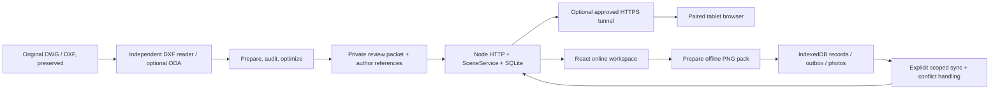

# Architecture and module ownership

## Components

| File/module | Responsibility |
|---|---|
| `client/main.jsx` | online app, filter/search, canvas/reference viewer, checklist, progress |
| `client/OfflineApp.jsx` | independent prepared field workspace and local records |
| `client/storage.mjs` | IndexedDB schema v2, atomic save, outbox and API synchronization |
| `client/offline-pack.mjs` | validate/verify/import/export packs and result bundles |
| `client/sync-scope.mjs` | select source/dataset queue and related photos |
| `client/model.mjs` | systems, checklists, geometry helpers, escaped CSV |
| `client/locale.mjs`, `language.mjs` | UI language, original evidence preservation, progress scope |
| `client/workflow.mjs` | view resume, valid anchors, single-flight saves |
| `server/local.mjs` | pairing, API, SQLite, private file serving |
| `server/scene.mjs` | bounded raster and geometry picking |
| `server/proxy-origin.mjs` | exact trusted origin policy for loopback HTTPS tunnel requests |
| `scripts/control*.ps1` | Windows UI, operation state, guarded errors and start/stop |
| `scripts/watch-team.ps1` | verify rotating localhost.run origin and update local paired shortcut |

## Data lifecycle

Source unchanged SHA-256 → prepared package UUID → manifest datasetId → record ID prefix `(SHA)-(dataset)-...`. Revision changes must create a new identifiable dataset; titles alone must never decide identity. There is only one active package per server. Previous packages are retained in ignored private storage; no automatic retention deletion.

SQLite uses `journal_mode=DELETE`, `synchronous=FULL`, tables `records`, `operations`, `audit`. Record update and audit are a transaction. `opId` makes retries idempotent; version mismatch yields 409. Photos are separate files, so full record+photo commit is not a global transaction; orphan photos and stale operations can accumulate. Backup storage as a consistent set after stopping the server.

Raster: viewport at most 1600×1200, at most 5000 visible objects; dense view fails explicitly, never silently truncates. Scene cache holds two view datasets, image cache twelve results; one active render at a time. This is bounded code behavior, not a load-test SLA.

## Deliberate boundaries

No multi-tenant accounts, RBAC, enterprise SSO, automatic engineering release, native DWG save, full BIM coordination or AI reasoning service. Browser language/local cache belongs to origin and device. Offline export is manual disaster recovery. Public release isolates source from factory data and old hosting Git history.
